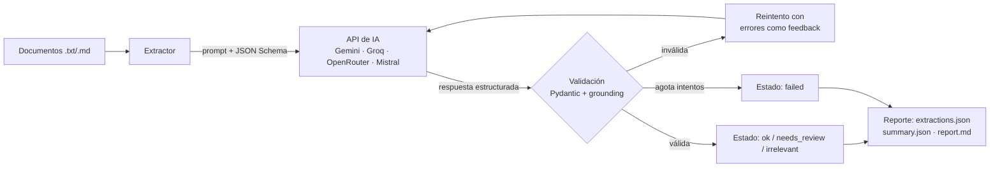

# doc-insight-agent

  

Agente de IA que **procesa documentos de texto (tickets y feedback de usuarios), extrae información relevante, la convierte en JSON validado y genera un reporte estructurado** con métricas y oportunidades de mejora de producto.

Es una Prueba de Concepto (PoC) acotada: resuelve una tarea concreta, mide su calidad con casos etiquetados y documenta sus límites.

## Problema que resuelve

Clasificar manualmente decenas de tickets (tipo, severidad, módulo afectado, qué mejorar) es lento e inconsistente. Este agente automatiza ese primer paso y **marca explícitamente qué casos necesitan revisión humana** en lugar de forzar una respuesta.

## Qué demuestra

| Competencia | Dónde verlo |
|---|---|
| Integración con APIs de IA (multi-proveedor) | `src/doc_insight/llm.py`: Gemini, Groq, OpenRouter, Mistral (planes gratuitos) y Anthropic opcional; reintentos con *backoff* ante límites de tráfico |
| Diseño de instrucciones y salida estructurada | `prompts.py`, `schema.py` |
| Validación y manejo de errores | `schema.py` (reglas de consistencia), `extractor.py` (reintento con feedback, *grounding*, límites) |
| Automatización de un proceso manual | `cli.py` + `report.py` (lote de documentos → JSON + Markdown) |
| Pruebas con casos normales, ambiguos e incompletos | `data/samples/`, `data/expected/`, `tests/` |
| Comparación de alternativas con criterios definidos | `evaluate --provider X` + `docs/EXPERIMENTOS.md` |

## Arquitectura



**Decisiones de diseño**

1. **Contrato único**: el JSON Schema que se le entrega al modelo se genera desde el modelo Pydantic. Una sola fuente de verdad. Se pide salida JSON (modo JSON nativo cuando el proveedor lo soporta; *tool use* forzado en Anthropic) y se tolera texto o bloques ```` ```json ```` alrededor.
2. **El modelo no es la última palabra**: toda respuesta pasa por validación. Reglas de consistencia (p. ej. un campo `null` debe declararse en `missing_fields`; un documento irrelevante debe tener categoría `other`).
3. **Anti-alucinación (*grounding*)**: el modelo debe citar fragmentos textuales (`evidence`); el código verifica que existan en el documento. Si no, se rechaza y se reintenta.
4. **Dos niveles de reintento**: (a) si la respuesta es inválida o no es JSON, se reintenta devolviéndole al modelo los errores del validador (máx. 3); (b) si falla la infraestructura (HTTP 429/5xx, red), el cliente reintenta con *backoff* exponencial respetando `Retry-After`. Los errores de autenticación no se reintentan.
5. **Incertidumbre explícita**: confianza < 0.6 o campos faltantes ⇒ `needs_review`. Es preferible derivar a una persona que clasificar mal en silencio.
6. **Resistencia a *prompt injection***: el documento se trata como dato (`<document>`), y hay un caso adversarial en las muestras.
7. **Reporte determinístico**: el resumen se calcula con código, no con el modelo, para que los números sean reproducibles y auditables.
8. **Proveedor desacoplado**: `LLMClient` es un `Protocol`; se cambia con `--provider` / `--model` y se testea sin red (cliente falso y transporte HTTP simulado).
9. **Pensado para planes gratuitos**: pausa configurable entre documentos (`--delay`) para respetar el límite de peticiones por minuto, y fallback automático si un modelo no soporta modo JSON.

## Obtener una API key gratuita

No hace falta pagar ni usar tarjeta para probar el proyecto. Elegí **un** proveedor:

| Proveedor | `--provider` | Dónde obtener la key | Modelo por defecto* | Notas |
|---|---|---|---|---|
| **Google AI Studio (Gemini)** | `gemini` | [aistudio.google.com/apikey](https://aistudio.google.com/apikey) | `gemini-3.8-flash` | Recomendado. Límites por minuto/día bajos y cambiantes; en el plan gratuito Google puede usar tus datos para mejorar sus productos. Puede no estar disponible en todas las regiones. |
| **Groq** | `groq` | [console.groq.com/keys](https://console.groq.com/keys) | `llama-3.3-70b-versatile` | Muy rápido; modelos open-source. |
| **OpenRouter** | `openrouter` | [openrouter.ai/keys](https://openrouter.ai/keys) | `meta-llama/llama-3.3-70b-instruct:free` | Una key para muchos modelos; los `:free` tienen cupos bajos y a veces se saturan. |
| **Mistral** | `mistral` | [console.mistral.ai](https://console.mistral.ai/) | `mistral-small-latest` | Plan gratuito con límites de tarifa. |
| Cualquier API compatible con OpenAI | `custom` | — | — | Requiere `--base-url` y `--model` (ej.: Hugging Face Inference Providers, Ollama local). |
| Anthropic | `anthropic` | console.anthropic.com | `claude-sonnet-4-6` | **De pago**, opcional (`pip install -e ".[anthropic]"`). |

\* Los nombres de modelo y los cupos gratuitos cambian con frecuencia. Si un modelo falla con "not found" (404), listá los disponibles para tu key con `doc-insight models --provider gemini --filter flash` y pasá uno con `--model`. **Verificá los límites vigentes en la consola de cada proveedor.**

## Instalación

```bash
git clone <tu-repo> && cd doc-insight-agent
python -m venv .venv && source .venv/bin/activate   # Windows: .venv\Scripts\activate
pip install -e ".[dev]"
cp .env.example .env                                  # completar la key del proveedor elegido
```

## Uso

```bash
# Procesar una carpeta de documentos y generar reportes en out/
doc-insight run data/samples --provider gemini

# Evaluar contra los casos etiquetados y comparar proveedores/modelos
doc-insight evaluate data/samples data/expected --provider gemini
doc-insight evaluate data/samples data/expected --provider groq
doc-insight evaluate data/samples data/expected --provider openrouter --model google/gemma-3-27b-it:free

# Si ves errores 429 (límite de tráfico), aumentá la pausa entre documentos
doc-insight run data/samples --provider gemini --delay 8

# Si ves 503 (modelo saturado), subí los reintentos o probá un modelo más liviano
doc-insight run data/samples --provider gemini --retries 10

# Tests (no requieren API key ni red)
pytest -q
```

Salidas de `run`:

- `out/extractions.json`: resultado por documento (datos validados, estado, intentos, error).
- `out/summary.json`: agregados (por categoría, severidad, área, confianza, revisión humana).
- `out/report.md`: reporte legible.

Ejemplo de extracción validada:

```json
{
  "is_relevant": true,
  "category": "bug",
  "severity": "high",
  "product_area": "inicio de sesión",
  "summary": "Ningún usuario de la empresa puede iniciar sesión desde ayer por un error 500.",
  "sentiment": "negative",
  "improvement_opportunity": null,
  "evidence": ["Error 500 al validar credenciales"],
  "confidence": 0.93,
  "missing_fields": []
}
```
*(Ejemplo ilustrativo del formato; los resultados reales dependen del modelo y se registran en `docs/EXPERIMENTOS.md`.)*

## Casos de prueba

| Tipo | Archivos | Qué se verifica |
|---|---|---|
| Normales | `normal_*` | Clasificación correcta con información suficiente |
| Ambiguos | `ambiguous_*` | Documento mixto o vago ⇒ se acepta más de una categoría y se espera baja confianza / `needs_review` |
| Incompletos | `incomplete_*` | Fragmentos o textos mínimos ⇒ no inventa datos, deriva a revisión |
| Adversarial | `adversarial_*` | Instrucciones incrustadas en el documento no alteran el comportamiento |
| Irrelevantes | `irrelevant_*` | Se descarta sin forzar una clasificación |

Los tests (`tests/`, 35) cubren: respuesta válida, reintento con feedback, agotamiento de intentos, evidencia inventada, respuesta que no es JSON, reintentos con *backoff* ante 429, error de autenticación, fallback sin modo JSON, cada proveedor con transporte HTTP simulado, documento vacío (sin gastar llamada), truncado y agregación del reporte.

## Límites conocidos

Ver [`docs/LIMITES.md`](docs/LIMITES.md). En resumen: sólo texto plano, un dominio (tickets), conjunto de prueba pequeño, severidad subjetiva, y el *grounding* verifica que la cita exista, no que la interpretación sea correcta.

## Roadmap

- Soporte de PDF e imágenes (extracción previa de texto / visión).
- Procesamiento en paralelo y caché por hash de documento.
- Conjunto de evaluación más grande con etiquetado por dos personas.
- Registro de latencia y tokens por modelo en `evaluate`.
- Soporte nativo de salida estructurada por proveedor (JSON Schema estricto) cuando esté disponible.
- Segundo modelo como verificador para casos `needs_review`.

## Licencia

MIT
